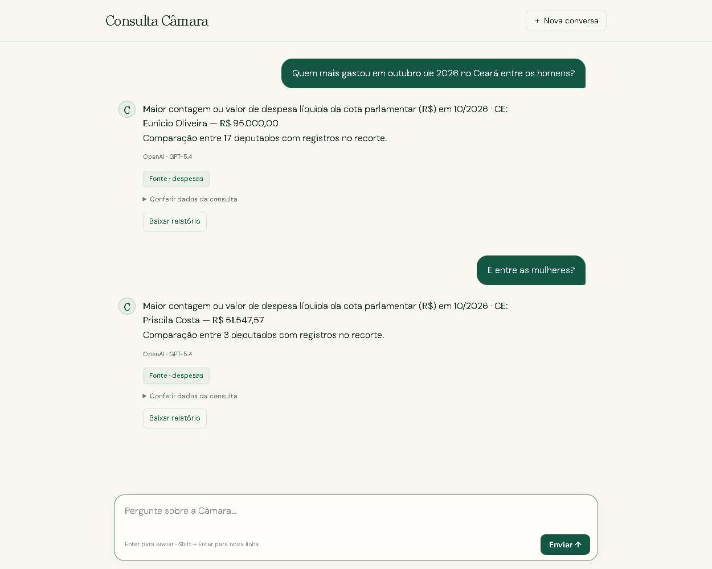

# Consulta Câmara

Chatbot em português com IA generativa para consultar dados oficiais da Câmara dos Deputados. A pergunta é transformada em plano estruturado; o fluxo valida argumentos, consulta fontes e responde com evidências. Suporta continuações, filtros, esclarecimentos e download de relatório.



## Arquitetura

Chat → FastAPI → planejamento com LLM → validação Pydantic → LangGraph → consultas Python às fontes oficiais → resposta com fontes.

GPT-5.4 é o provedor prioritário quando existe chave configurada. Um servidor local compatível pode ser usado como alternativa. O modo simples é uma contingência limitada. Não há treinamento de modelo.

O código consulta frequência, despesas da cota, autoria/coautoria de PLs, votações e ementas, além de capacidades de cadastro, comissões, eventos, partidos e frentes. Operações e filtros são restritos ao catálogo implementado. [Capacidades](CAPACIDADES.md) · [Mapa da API](MAPA-API.md).

## Executar com Python 3.12

```sh
python -m venv .venv
# Ative o ambiente: Windows .venv\Scripts\Activate.ps1; Linux/macOS source .venv/bin/activate
python -m pip install -r requirements.txt
python configurar_openai.py
python servico.py
```

O configurador pede a chave com entrada oculta e a salva na configuração do usuário, fora do repositório. Alternativamente, forneça `OPENAI_API_KEY` como variável de ambiente. Nunca inclua o valor em código ou commits. As chamadas podem consumir créditos.

Abra http://127.0.0.1:18182/ . A API está em `/docs`, o grafo em `/grafo` e o catálogo em `/capacidades`. Sem um modelo configurado, o modo simples não oferece compreensão equivalente à experiência com IA.

### Modelo local opcional

Configure `MODELO_URL` para um servidor compatível com Chat Completions e `MODELO_NOME` com seu alias. `MODELO_ROTULO` identifica o modelo na interface; `MODELO_CHAVE` autentica o servidor, se necessário. Pesos e executável não acompanham este repositório. O padrão tenta o alias `curso` em `http://127.0.0.1:18183/v1/chat/completions`.

### Docker Compose opcional

Copie `.env.example` para `.env`, preencha a chave apenas localmente e execute:

```sh
docker compose up --build -d
```

O exemplo atende somente em loopback, em http://127.0.0.1:18182/ . Ele inclui API e atualizador com armazenamento próprio. Uma publicação externa exige HTTPS, configuração do proxy e dos IPs confiáveis, cotas e revisão operacional adequadas ao seu ambiente. Não contém configurações ou acessos da instância de avaliação.

## Exemplos

- “Quem mais gastou no Ceará em outubro de 2026 entre os homens?” → “E entre as mulheres?” → “Agora em setembro.”
- “Quais projetos foram votados recentemente?” → “Só três.”
- “Quem escreveu o PL 1638/2025?” → “Como anda a tramitação dele?”
- “Quem faz parte da CFT?” → “Que eventos ela tem esta semana?”
- “Explique o PL mais recente de Danilo Forte.” → “E em 2025?”

Na última consulta, o critério é a data de apresentação com autoria/coautoria registrada, não a data da assinatura. Sem ano explícito, o sistema informa o recorte do ano corrente. Sem deputado identificado, pede o nome.

## Testes

```sh
python -m pytest -q
python testar_modelos.py
```

Os testes usam fixtures e bloqueiam rede externa; não precisam de chave nem consomem API. O segundo comando testa o roteamento de provedores com respostas simuladas. A avaliação real anterior cobriu 30 perguntas online (28 passaram inicialmente e duas falhas de fonte passaram em repetição dirigida) e 14 reconciliações numéricas; veja [validação](docs/VALIDACAO.md).

## Atualização e operação

O sistema consulta fontes sob demanda e registra as URLs oficiais utilizadas. `python atualizar_fontes.py --limite 25` renova um lote limitado sem chamar LLM. O serviço de atualização do Compose executa a rotina a cada 900 segundos. Cache HTTP e índice de votos têm janela de 15 minutos; frequência e índices anuais têm políticas próprias descritas na documentação. Falha de fonte pode usar cache anterior com aviso. Data de obtenção não é data do evento legislativo.

`CONSULTA_PUBLIC_MODE=1` ativa limites persistentes e bloqueia `/ops/*` para visitantes. Configure `CONSULTA_DAILY_LIMIT`, `CONSULTA_IP_HOURLY_LIMIT` e os IPs confiáveis do proxy conforme seu ambiente. Cotas de pedidos não representam garantia de teto financeiro. SQLite armazena conversas e operação; não é uma réplica do acervo parlamentar.

## Documentação

- [Fluxo técnico completo e prompts](docs/FLUXO-TECNICO.md)
- [Explicação do projeto](docs/PROJETO.md)
- [Prompts gerados do código](PROMPTS.md)
- [Avaliação e limitações](docs/VALIDACAO.md)
- [Diagrama executável](workflow.mmd)

O projeto corresponde ao Tema 2: Chat/Assistente com conexão a API externa. Os três arquivos da submissão acadêmica são preparados separadamente do código. A URL da instância para avaliação é informada na atividade.

Faltas não são inferidas de ausência de voto. Ausência de registro não significa zero. Coautoria ou uma votação relacionada não comprovam aprovação integral nem qualidade política. Não há garantia de resposta a toda frase livre, disponibilidade permanente ou certificação LGPD.

A fonte DM Sans acompanha sua licença em `dm-sans-license.txt`. Bibliotecas têm licenças próprias.
